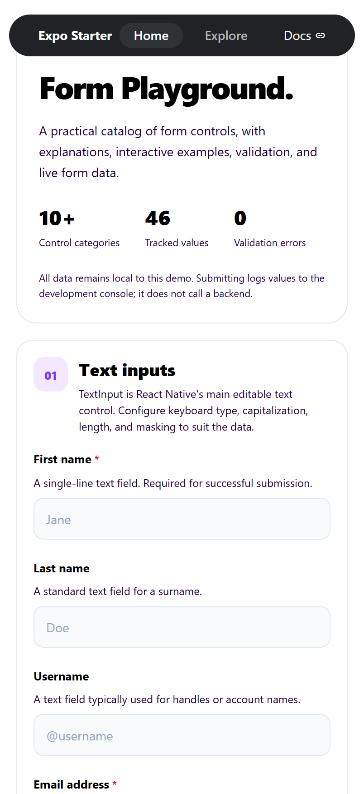
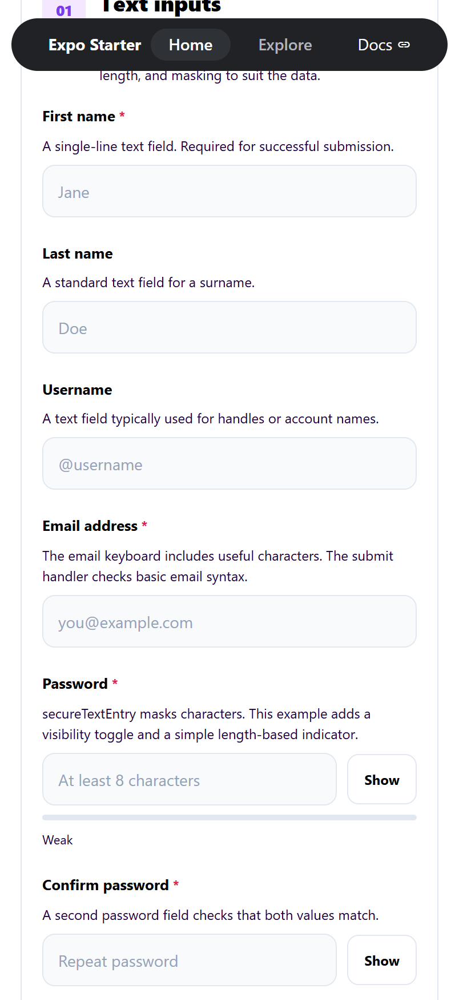
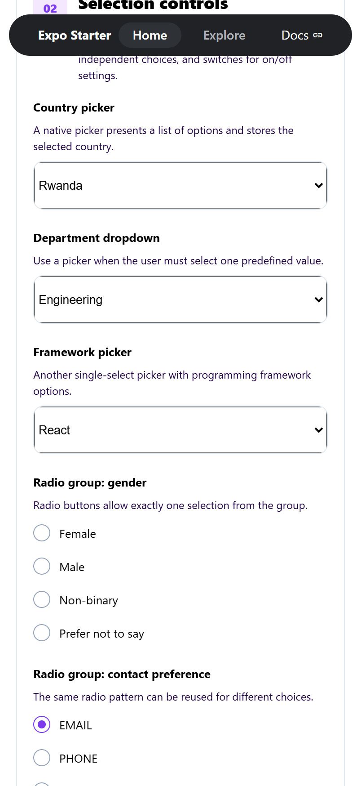
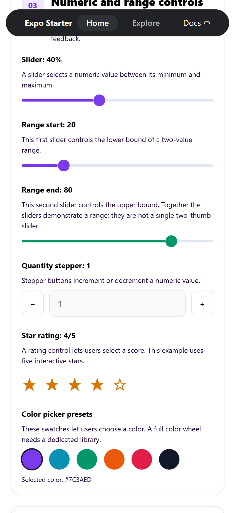
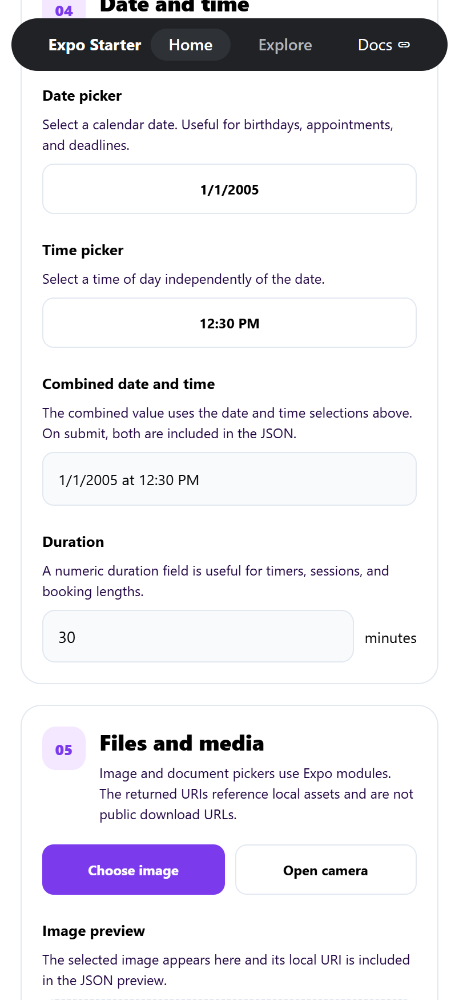
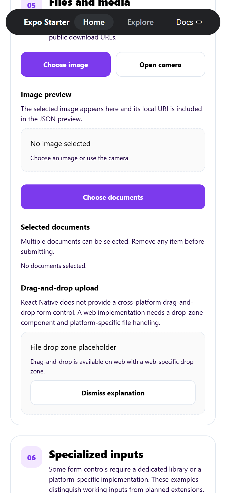
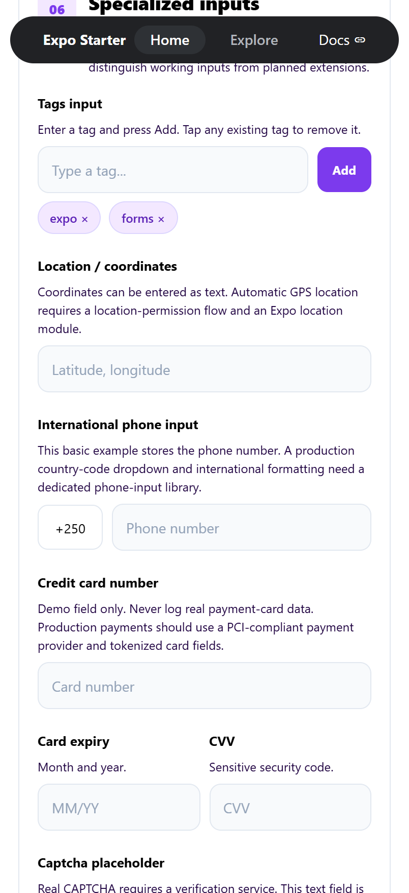
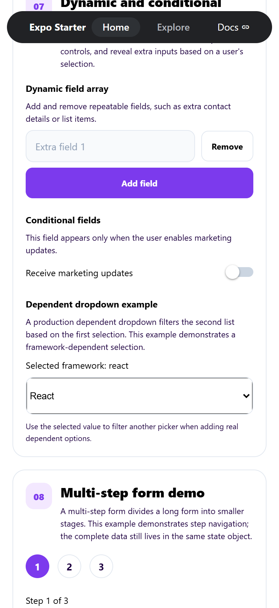
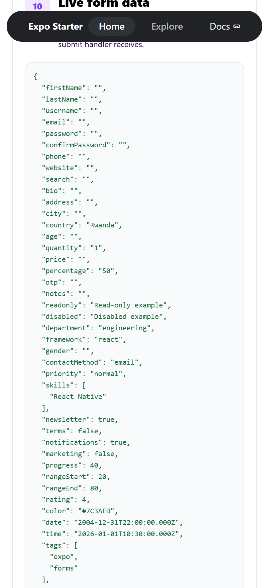

# Form Playground

An interactive catalog of form controls built with [Expo](https://expo.dev) and React Native. Form Playground documents common (and some tricky) mobile form patterns — inputs, selectors, sliders, date/time pickers, uploads, validation, dynamic fields, and multi-step flows — as one runnable app with live form data.

Every control is paired with an explanation, an interactive example, and an entry in a live JSON preview so you can see the exact data shape a submit handler receives. Everything runs locally; submitting logs to the development console and never calls a backend.

## Screenshots

| Hero | Text inputs | Selection controls |
| --- | --- | --- |
|  |  |  |

| Numeric & range | Date & time | Files & media |
| --- | --- | --- |
|  |  |  |

| Specialized inputs | Dynamic fields | Live form data |
| --- | --- | --- |
|  |  |  |

## What's inside

The main screen (`src/app/index.tsx`) is organized into ten sections:

1. **Text inputs** — single-line, multiline, password with visibility toggle and strength hint, email, phone, URL, search, numeric variants, OTP, clearable, prefix/suffix, read-only, disabled, and character-limited fields.
2. **Selection controls** — native pickers, radio groups, multi-select checkboxes, segmented control, switches, select-all/clear-all, searchable autocomplete, and chip/tag selectors.
3. **Numeric and range controls** — sliders, a two-slider range, a quantity stepper, a star rating, and color swatches.
4. **Date and time** — native date picker, time picker, combined display, and duration.
5. **Files and media** — image picker (library and camera) with preview, multi-document picker, and a drag-and-drop placeholder.
6. **Specialized inputs** — tags, coordinates, international phone, card fields, captcha placeholder, Markdown source, and honest "not installed" placeholders for signature, rich text, and emoji picker.
7. **Dynamic and conditional fields** — repeatable field arrays and fields that appear based on other selections.
8. **Multi-step form demo** — a three-step flow over the same shared state object.
9. **Validation and form actions** — inline errors, a required-terms checkbox, an error summary, submit, and reset.
10. **Live form data** — a serialized JSON preview of the current state plus a "log JSON" action.

## Tech stack

- **Expo** SDK 57 with **Expo Router** (file-based routing, typed routes)
- **React Native** 0.86 / **React** 19
- **TypeScript**
- Form controls: `@react-native-community/slider`, `@react-native-community/datetimepicker`, `@react-native-picker/picker`, `expo-checkbox`, `expo-image-picker`, `expo-document-picker`

## Getting started

Requires Node.js and the [Expo CLI](https://docs.expo.dev/more/expo-cli/).

```bash
npm install
npx expo start
```

Then open the app in a:

- [development build](https://docs.expo.dev/develop/development-builds/introduction/)
- [Android emulator](https://docs.expo.dev/workflow/android-studio-emulator/)
- [iOS simulator](https://docs.expo.dev/workflow/ios-simulator/)
- [Expo Go](https://expo.dev/go) for quick previews

Some native modules (date/time picker, sliders, pickers) behave differently from bundle to bundle — a development build is recommended for the full experience.

## Scripts

```bash
npm start        # start the dev server
npm run android  # start on Android
npm run ios      # start on iOS
npm run web      # start in the browser
npm run lint     # lint with expo lint
npx tsc --noEmit # typecheck
```

## Project structure

```
src/
  app/                 # Expo Router routes
    _layout.tsx        # tab navigator + theme provider
    index.tsx          # Form Playground catalog (main screen)
    explore.tsx        # starter "Explore" tab
  components/          # shared UI (tabs, themed text/view, collapsible, ...)
  constants/           # theme tokens
  hooks/               # color scheme / theme hooks
screenshots/           # README screenshots
```

`src/app/` is the routing root: every file there is a screen and every `_layout.tsx` defines a navigator. Keep non-route code (components, hooks, constants) outside `src/app/`.

## Notes and limitations

- All data stays local to the demo — no backend calls.
- Some controls are intentionally honest placeholders (signature pad, rich-text editor, full emoji picker, real CAPTCHA, PCI-compliant card fields) rather than fake implementations.
- Drag-and-drop upload is web-only by design; React Native has no cross-platform drop-zone control.

## License

MIT — see [LICENSE](./LICENSE).
